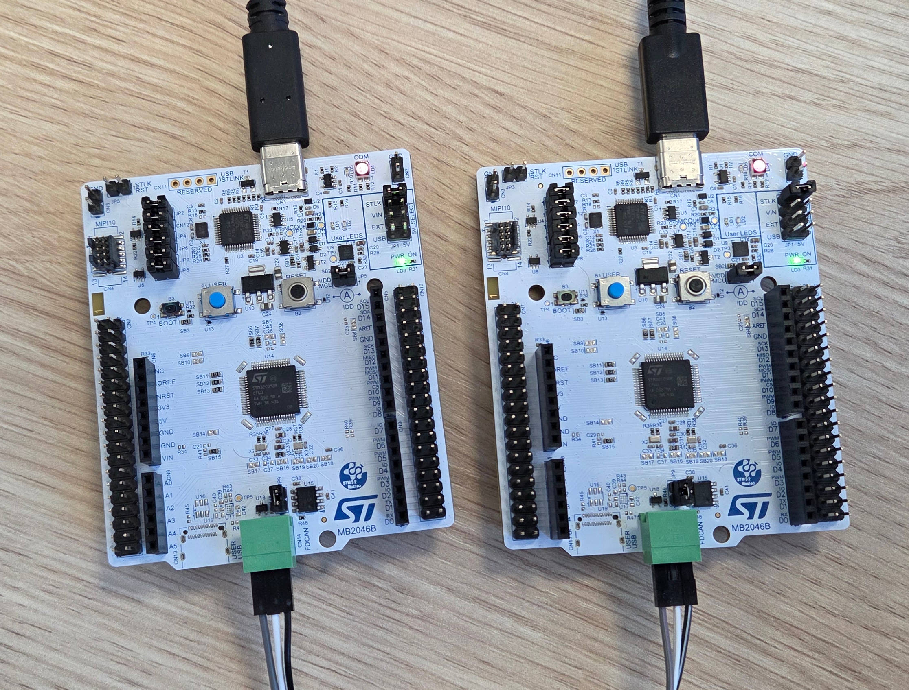

# SLCAN Bridge

Zephyr-based SLCAN bridge for the Nucleo C092RC and Nucleo H7S3L8 boards.

## Overview

The SLCAN bridge project enables communication between a host system and CAN networks using a Nucleo board. It implements the SLCAN protocol over UART and supports both Classic CAN and CAN FD frames. The bridge is built on the Zephyr RTOS, leveraging its device drivers and message queue mechanisms for efficient CAN frame handling.

## Supported boards

| Board         | Zephyr board    | `N` reply | Host link           | CAN transceiver                        | FDCAN clock |
| ------------- | --------------- | --------- | ------------------- | -------------------------------------- | ----------- |
| Nucleo C092RC | `nucleo_c092rc` | `NC092`   | ST-LINK VCP, USART2 | On-board MCP2562FD                     | 48 MHz HSE  |
| Nucleo H7S3L8 | `nucleo_h7s3l8` | `NH7S3`   | ST-LINK VCP, USART3 | External Adafruit CAN Pal (TJA1051T/3) | 60 MHz PLL2 |

Both run the same firmware. Each board's differences are in `slcan_bridge/boards/<board>.overlay` (and `.conf`): the UART DMA channels and, on the H7S3L8, the external transceiver and the FDCAN clock. The H7S3L8 board files clock the FDCAN from the 24 MHz HSE; the overlay switches it to 60 MHz from PLL2 (VCO 600 MHz, P and Q divided by 10, R/S/T kept at 200 MHz), the lowest clock that every SLCAN bitrate divides. The Cortex-M7 of the H7S3L8 has a data cache, so `nucleo_h7s3l8.conf` enables `CONFIG_NOCACHE_MEMORY`, and the UART DMA buffers in `main.c` are marked `__nocache`. On the C092RC, which has no data cache, `__nocache` has no effect.

### Wiring the Adafruit CAN Pal to the Nucleo H7S3L8

The H7S3L8 has no CAN transceiver. Connect an [Adafruit CAN Pal](https://learn.adafruit.com/adafruit-can-pal/pinouts) to FDCAN1 on the Zio connectors:

| CAN Pal | Nucleo H7S3L8                                            |
| ------- | -------------------------------------------------------- |
| Vcc     | 3V3, CN8 pin 7                                           |
| GND     | GND, CN9 pin 23                                          |
| TX      | PD1 (FDCAN1_TX), CN9 pin 27                              |
| RX      | PD0 (FDCAN1_RX), CN9 pin 25                              |
| SLNT    | Not connected (the TJA1051T/3 pulls it low: normal mode) |

Power the CAN Pal from 3V3, not 5V: its RX output follows Vcc, and the MCU logic runs at 3.3 V. CAN H and CAN L go to the terminal block, and the **Termination** switch turns its 120 Ω on or off.

## SLCAN Protocol

Refer to the [slcan documentation](doc/slcan.md) for details on the supported SLCAN commands and protocol differences.

## Zephyr project setup

### Requirements

Run this setup on Linux with a supported host architecture: `x86_64` or `aarch64`. The setup script requires Bash, `uv`, Git, CMake (3.20 or newer), and Ninja, plus internet access. Device tree compiler and other host tools come from the Zephyr SDK.

### Install

From the repository root, run:

```sh
./zephyr-init.sh
```

The script:

1. Creates a Python virtual environment (with pip, which `west packages pip` needs) and installs West into it.
2. Configures this directory as the West workspace root and shallowly updates the projects pinned by `west.yml`. On a rerun it first reverts the Zephyr patches (`west patch clean`), so the update starts from unmodified trees.
3. Installs the Python requirements of those projects.
4. Applies the patches listed in `zephyr/patches.yml` (`west patch apply`, see [Zephyr patches](#zephyr-patches)).
5. Runs `west sdk install`, which downloads the Zephyr SDK version named in `deps/zephyr/SDK_VERSION`, checks it against the release `sha256.sum`, extracts it into this directory, and runs its `setup.sh` to install the `arm-zephyr-eabi` GNU toolchain and the host tools.

The script is safe to rerun. If an SDK of the same version is already installed, West skips the download but runs `setup.sh` again. West looks for an installed SDK wherever CMake finds one (the user package registry, `~`, `/opt`, ...). If it picks one outside this directory, the script stops with an error; remove or unregister that SDK and rerun.

Files created in this repository directory:

```text
.venv/                    Python environment with West
.west/config              West workspace configuration
deps/zephyr/              Zephyr
deps/modules/             Modules imported from Zephyr's manifest
zephyr-sdk-<version>/     Zephyr SDK
build/<board>/            Build output of make.sh
```

Outside it, the SDK's `setup.sh` registers the SDK in the CMake user package registry under `~/.cmake/packages/Zephyr-sdk/`.

### Zephyr patches

`zephyr/patches/zephyr/` holds local changes to Zephyr v4.4.2. `zephyr/patches.yml` lists them with their SHA-256 checksums; `west patch apply` refuses a patch whose checksum does not match.

| Patch                                                                   | Purpose                                                                                                                           |
| ----------------------------------------------------------------------- | --------------------------------------------------------------------------------------------------------------------------------- |
| `0001-drivers-can-mcan-add-tx-fifo-mode.patch`                          | Adds `CONFIG_CAN_MCAN_TX_FIFO` (enabled in `prj.conf`), so the FDCAN sends frames in the order the host queued them.              |
| `0002-drivers-can-mcan-zero-out-rx-frame.patch`                         | Backport of upstream `1e1855620db4`: flags of a received frame no longer carry over to the next frame read in the same interrupt. |
| `0003-drivers-can-mcan-ignore-tx-events-for-completed-tx-buffers.patch` | Backport of upstream `6cfafba540a8`: a frame completing while the controller goes bus-off no longer calls a NULL Tx callback.     |

`west patch list` shows the patches, `west patch clean` reverts them (it runs `git checkout .` and `git clean -dfx` in `deps/zephyr`, discarding any other local change there), and `west patch apply` applies them again. To change a patch, edit Zephyr in `deps/zephyr`, write that change's diff (`git -C deps/zephyr diff`, without the other patches' hunks) to its patch file, and update the file's `sha256sum` in `zephyr/patches.yml`.

### Build

To build after installation, run:

```sh
./make.sh                  # nucleo_c092rc, output in build/nucleo_c092rc
./make.sh nucleo_h7s3l8    # output in build/nucleo_h7s3l8
```

It sets `ZEPHYR_SDK_INSTALL_DIR` so the build prefers the SDK in this directory over any other registered one. `./flash.sh [board]` flashes that build with STM32CubeProgrammer; the board defaults to `nucleo_c092rc` as well.

### Clean

To remove the generated local environment, workspace, build output, SDK, and the SDK's CMake package registry entry, run:

```sh
./clean-all.sh
```

### Test with two boards

Flash both boards and wire their CAN connectors together (CANH-CANH, CANL-CANL, GND, terminated at both ends). The boards can be of either type, for example a C092RC and an H7S3L8 with its CAN Pal. Then run:

```sh
./test-boards.py                     # board A /dev/ttyACM0, board B /dev/ttyACM1
./test-boards.py --list              # show the tests
./test-boards.py -k burst -v         # run tests matching "burst", log all serial traffic
```

`uv` provides `pyserial`; `.venv/bin/python test-boards.py` works as well. Options set the ports (`--port-a`, `--port-b`), bitrates (`--bitrate 0-8`, `--data-bitrate 0-5`), burst length (`--burst`) and random seed (`--seed`). `--data-bitrate 5` needs two H7S3L8 boards; the script reads each board's `N` reply and refuses a data bitrate a board does not support. Before each test both channels are reopened at the chosen bitrates. The tests send Classic, extended, RTR and CAN FD frames (all DLCs, with and without BRS) both ways and compare them. They also check rejected commands (including `Y5` on the C092RC), line endings, timestamps, sequenced bursts in each direction and both at once, listen-only mode, the TX mailboxes filling when no node ACKs, and that pending frames with descending IDs leave in the order sent. The exit code is 0 only if every test passes.

Before the tests, the script sends `V` and `N` to each board. If a board does not answer, it reports whether any bytes arrived at all (none: board not running the firmware, wrong port, or the port held by another program; unterminated bytes: baud mismatch) and exits with code 2. It also exits with code 2 if a board's `N` reply is not a known board, or if `--data-bitrate` is higher than a board supports.

Two Nucleo C092RC boards at the default bitrates:



```text
A=/dev/ttyACM0 B=/dev/ttyACM1 S6 (500k) Y2 (2M) seed=3796532915
PASS identification: A V0102 NC092, B V0102 NC092
PASS pipelined_commands
PASS classic_standard
PASS classic_extended
PASS remote_frames
PASS fd_frames
PASS lowercase_hex
PASS line_terminators
PASS rejected_commands
PASS closed_channel
PASS timestamps: board 204 ms vs host 201 ms
PASS burst_classic: 1000 frames per stream in 1.99 s (502 frames/s; A->B 0 BEL); 1000 frames per stream in 2.00 s (501 frames/s; B->A 0 BEL)
PASS burst_fd: 1000 frames per stream in 3.10 s (322 frames/s; A->B 0 BEL); 1000 frames per stream in 3.24 s (309 frames/s; B->A 0 BEL)
PASS burst_bidirectional: 1000 frames per stream in 3.07 s (651 frames/s; A->B 0 BEL, B->A 0 BEL)
PASS listen_only
PASS no_ack: 3 frames queued before BEL, F22
PASS tx_order: 3 pending frames, IDs 700 600 500

17/17 passed
```

Two Nucleo H7S3L8 boards with CAN Pal transceivers, CAN FD data phase at 5 Mbit/s (`--data-bitrate 5`):

```text
A=/dev/ttyACM0 B=/dev/ttyACM1 S6 (500k) Y5 (5M) seed=707410551
PASS identification: A V0102 NH7S3, B V0102 NH7S3
PASS pipelined_commands
PASS classic_standard
PASS classic_extended
PASS remote_frames
PASS fd_frames
PASS lowercase_hex
PASS line_terminators
PASS rejected_commands
PASS closed_channel
PASS timestamps: board 203 ms vs host 200 ms
PASS burst_classic: 1000 frames per stream in 0.97 s (1030 frames/s; A->B 0 BEL); 1000 frames per stream in 0.99 s (1005 frames/s; B->A 0 BEL)
PASS burst_fd: 1000 frames per stream in 2.33 s (430 frames/s; A->B 0 BEL); 1000 frames per stream in 2.37 s (421 frames/s; B->A 0 BEL)
PASS burst_bidirectional: 1000 frames per stream in 2.32 s (863 frames/s; A->B 0 BEL, B->A 0 BEL)
PASS listen_only
PASS no_ack: 3 frames queued before BEL, F22
PASS tx_order: 3 pending frames, IDs 700 600 500

17/17 passed
```

This run confirms on hardware that FDCAN1 runs from the 60 MHz PLL2 clock and that 64-byte CAN FD frames with bitrate switching pass at 5 Mbit/s (`fd_frames`, `burst_fd`). It also confirms that the H7S3L8 accepts `Y5` (`closed_channel`), that the CAN Pal works with SLNT left open, and that the 1 Mbaud DMA UART with its buffers in uncached RAM keeps up through the STLINK-V3EC (`pipelined_commands`, bursts with no drops).

#### Burst throughput

The burst tests run in lockstep: the script writes one frame command and waits for its ACK before writing the next. No `BEL` occurred, so the TX mailboxes never filled and the CAN bus was never the bottleneck. A Classic 8-byte frame takes about 0.23 ms at 500 kbit/s, and a 64-byte CAN FD frame with BRS at 500 kbit/s / 5 Mbit/s under 0.25 ms. The frames/s figures therefore measure the round trip of one command between the host and the board.

| Per frame                  | Command line   | UART time at 1 Mbaud | C092RC (ST-LINK/V2-1) | H7S3L8 (STLINK-V3EC) |
| -------------------------- | -------------- | -------------------- | --------------------- | -------------------- |
| Classic, 8 bytes           | 22 characters  | 0.22 ms              | 2.0 ms                | 0.98 ms              |
| CAN FD, 64 bytes           | 134 characters | 1.34 ms              | 3.2 ms                | 2.35 ms              |
| Round trip minus UART time |                |                      | about 1.8 ms          | about 0.8-1.0 ms     |

On each board, the round trip minus the UART time is nearly the same for both frame sizes. It does not depend on the CAN data rate either (Y2 on the C092RC, Y5 on the H7S3L8): Classic frames have no data phase, and both rates are far faster than the serial link. The H7S3L8's faster CPU (200 MHz against 48 MHz) does not explain the difference, because parsing a command takes microseconds. The overhead most likely comes from the USB link of the ST-LINK. The ST-LINK/V2-1 is a USB full-speed device, polled in 1 ms frames, so a write and its reply take about two frames. The STLINK-V3EC is a USB high-speed device with 125 µs microframes.

`burst_bidirectional` runs a Classic stream on one board and a CAN FD stream on the other in parallel. It ends when the slower CAN FD stream finishes (3.07 s and 2.32 s, about the time of `burst_fd` alone) and counts the frames of both streams, so its rate is about twice the CAN FD rate.

A host that streams commands without waiting for each ACK is no longer limited by USB latency. It is then limited by the 1 Mbaud serial link (about 4,500 Classic or 740 CAN FD command lines per second) or by the CAN bus (about 4,300 Classic 8-byte frames per second at 500 kbit/s), whichever is slower. The test script does not measure this.

## Firmware behavior

### Status flags (`F`)

`F` works only while the channel is open, as in LAWICEL. It returns `Fxx\r`, where `xx` is a hex bitmask. Latched flags are cleared by each `F` read and by `O`/`L`. The current controller state (error warning, error passive, bus-off) is added to every reply.

| Bit | Meaning                                                                             |
| --- | ----------------------------------------------------------------------------------- |
| 0   | Received CAN frame dropped: the RX message queue or the serial TX buffer was full   |
| 1   | Frame not queued: no free CAN TX mailbox (`t`/`T`/... answered with BEL)            |
| 2   | Error warning                                                                       |
| 3   | Serial input from the host dropped: the UART RX buffer was full                     |
| 5   | Error passive                                                                       |
| 6   | Arbitration lost (reported only in one-shot mode, which this firmware does not use) |
| 7   | Bus-off: the controller went bus-off and discarded the frames in its TX mailboxes   |

### Transmit acknowledgement

`\r` after a transmit command means the frame was queued in a CAN TX mailbox, not that it was sent. A frame that no node ACKs is not reported as failed: the controller retransmits it until a node ACKs it or the channel is closed with `C`, and its transmit error counter rises until it is error passive (`F` bits 2 and 5). Meanwhile the mailboxes stay full, so later transmit commands are answered with BEL and set bit 1.

### CAN FD

`O` and `L` always open the controller in CAN FD mode. Classic CAN frames are sent and received unchanged, and `d`/`D`/`b`/`B` work without a prior `Y`. The data phase defaults to 2 Mbit/s (nominal: 500 kbit/s); `Y0`-`Y5` change it while the channel is closed. `Y5` (5 Mbit/s) works only on the H7S3L8, whose 60 MHz FDCAN clock gives 12 time quanta per bit. The C092RC answers it with BEL: its FDCAN clock is the 48 MHz HSE, and 48 MHz / 5 Mbit/s = 9.6 time quanta per bit is not an integer. Both transceivers, the on-board MCP2562FD and the CAN Pal's TJA1051T/3, are rated up to 5 Mbit/s.

### Listen-only (`L`)

A channel opened with `L` sends no ACKs and no frames, but it receives. Receivers ignore the ACK slot, so when no other node ACKs a frame, every retransmission of it is a valid frame to the listener: it reports the same frame repeatedly until the sender closes its channel.

### Timestamps (`Z`)

`Z1` turns timestamps on and `Z0` turns them off; both work only while the channel is closed. With timestamps on, every received frame carries four extra hex digits before the `\r`: the arrival time in milliseconds, wrapping at 60000 (`0000`-`EA5F`).

### Command parsing

Commands end with `\r`; a bare `\n` also ends a command, and the `\n` of a `\r\n` pair is ignored. A frame command must have exactly the length its DLC implies (no data for `r`/`R`), and its ID must fit 11 or 29 bits. A line longer than 256 characters gets one BEL, and the rest of it is discarded.

### Serial throughput

At 1 Mbaud the serial link carries about 100 kB/s. A busy bus produces more than that, for example ~198 kB/s for classic 8-byte frames at 1 Mbit/s, or ~460 kB/s for 64-byte CAN FD frames at a 2 Mbit/s data rate. The firmware then drops whole received frames (never partial lines) and sets `F` bit 0.

## Review notes

### Fixed

1. The UART TX interrupt discarded bytes that `uart_fifo_fill()` did not accept. The STM32 driver accepts only 1-2 bytes per call with the FIFO disabled, so most output was lost. It now uses `ring_buf_get_claim`/`ring_buf_get_finish`, so unsent bytes stay queued.
2. `can_send()` with a NULL callback waits `K_FOREVER` for transmit completion. Without an ACKing node, the main loop hung forever. Transmission is now asynchronous with `K_NO_WAIT`.
3. A full serial TX buffer truncated SLCAN lines mid-frame. Received frames are now dropped whole. Command responses wait for buffer space.
4. `CONFIG_CAN_ACCEPT_RTR` was unset, so the driver rejected every incoming RTR frame. It is now enabled in `prj.conf`.
5. `F` always returned `F00`. It now reports real flags (see above).
6. `Z` was ACKed without adding timestamps. `Z1`/`Z0` now turn millisecond timestamps on and off (see above).
7. The main loop woke every 100 µs. It now sleeps in `k_poll` on the CAN RX message queue and a semaphore given when UART data arrives.
8. FD mode was enabled only after `Y` and could not be disabled again. The channel now always opens FD-capable, so `d`/`D`/`b`/`B` work without `Y`.
9. Results of the startup bitrate calls were ignored; the firmware now stops if they fail. `S`/`Y` no longer change state when the bitrate is rejected.
10. After a command line overflowed the 256-byte buffer, the rest of the line was parsed as a new command. It is now discarded up to the end of the line.
11. Frame commands accepted trailing characters and out-of-range IDs. The length must now match the DLC exactly, and IDs must fit 11/29 bits.
12. `\r\n` from the host produced two ACKs. The `\n` of a CRLF pair is now ignored.
13. The overlay's redundant `&fdcan1 { status = "okay"; }` was removed; the board DTS already enables `fdcan1`.
14. The main stack was ~98% full on the transmit path with no overflow detection. The large buffers are now `static` and the MPU stack guard is enabled (see below).
15. At 1 Mbaud, commands sent back to back lost bytes (bytes 3-5 of a burst on hardware), so the board stopped answering after the first multi-command write. USART2 has no RX FIFO, and the interrupt-driven RX path was held off for longer than one byte time (10 µs). The UART now uses the async API with DMA: RX into a circular 256-byte buffer, TX straight from the ring buffer. The `pipelined_commands` test sends 64 commands in one write.
16. The FDCAN TX mailboxes ran as a priority queue: pending frames left lowest ID first, and frames with the same ID in unpredictable order, which breaks protocols such as ISO-TP that rely on frame order. `CONFIG_CAN_MCAN_TX_FIFO` (Zephyr patch 0001) now sends them in the order the host queued them. The `tx_order` test queues descending IDs while no node ACKs and checks the receive order.
17. Zephyr 4.4.2 zeroed the received frame once per interrupt, not per frame, so flags carried over when one interrupt read several frames: a standard frame after an extended one was reported as `T`, a classic frame after a CAN FD one as `d`/`b`. Zephyr patch 0002 backports the upstream fix.
18. In Zephyr 4.4.2, when a frame's Tx event and a bus-off were handled in the same interrupt, the bus-off handler completed every Tx buffer first, and the Tx event handler then called the cleared, NULL, callback, crashing the firmware, and gave the TX semaphore a second time. Zephyr patch 0003 backports the upstream fix.

### Stack usage

Per-function frame sizes come from a `-fstack-usage` build. Calls through driver function pointers (e.g. `api->send`) were followed by hand.

| Worst path (transmit command)                                        | Before      | After      |
| -------------------------------------------------------------------- | ----------- | ---------- |
| `z_thread_entry` + `bg_thread_main`                                  | 72 B        | 72 B       |
| `main` (command parser and formatter inlined)                        | 600 B       | 208 B      |
| `handle_tx_frame` → `can_send` → `can_mcan_send` → message RAM write | ~304 B      | ~304 B     |
| Exception frame when an interrupt arrives                            | 32 B        | 32 B       |
| **Total of `CONFIG_MAIN_STACK_SIZE=1024`**                           | **~1008 B** | **~616 B** |

`cmd_buf[256]` and the 144-byte formatter buffer are now `static`; only the main thread uses them. `CONFIG_ARM_MPU` and `CONFIG_HW_STACK_PROTECTION` put an MPU guard below each thread stack, so an overflow raises a fault instead of corrupting RAM. Together, the two changes raise RAM use from 13.4 KB to 15.0 KB (of 30 KB) and flash from 25.1 KB to 26.0 KB.
